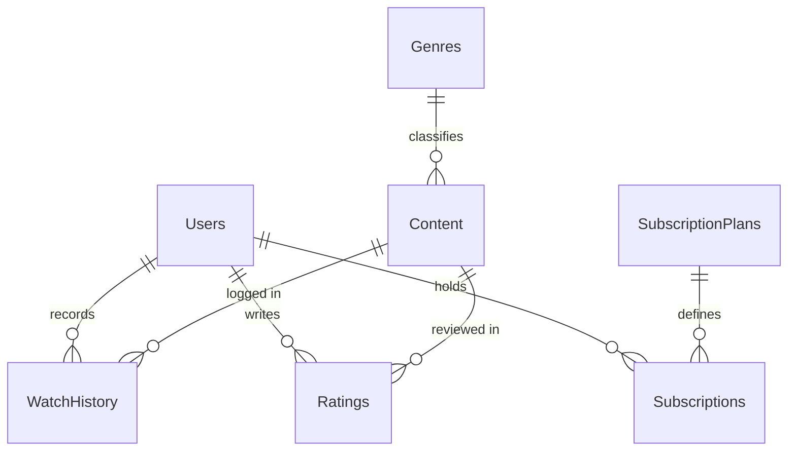

# StreamSphere — OTT Platform Management System
** DBMS Laboratory Mini-Project**  
*Comprehensive Relational Database System with MySQL 8.0, Node.js/Express REST API, and Modern React Dashboard.*

---

## 1. Executive Summary & Project Overview

**StreamSphere** is a complete,  (OTT) streaming platform management system built specifically for  DBMS laboratory

Unlike simple UI prototypes or systems that mock data in local storage or JavaScript arrays, **StreamSphere is strictly database-first**: every single KPI card, content catalog item, transaction, rating, and report is queried in real time from a normalized **MySQL 8.0 InnoDB** relational database.

### Core Evaluation Highlights:
- **7 Normalized Relational Tables:** `Users`, `Genres`, `Content`, `SubscriptionPlans`, `Subscriptions`, `WatchHistory`, `Ratings`.
- **Formally Normalized to 3NF / BCNF:** Eliminates insertion, deletion, and update anomalies with complete functional dependency proofs.
- **Advanced SQL Database Objects:**
  - **SQL View (`vw_content_performance`):** 4-table join calculating streaming telemetry and audience ratings.
  - **SQL View (`vw_active_subscriptions`):** Real-time customer access status with `DATEDIFF` countdown.
  - **Stored Procedure (`sp_register_subscription`):** Atomic subscription activation with transaction management, date calculation (`DATE_ADD`), and SQL exception handling (`GET DIAGNOSTICS`).
  - **MySQL Trigger (`trg_validate_subscription_insert`):** Server-side data integrity trigger raising `SIGNAL SQLSTATE '45000'` when business constraints are violated.
  - **Stored Function (`fn_calculate_user_watch_hours`):** Mathematical transformation of playback telemetry into watch hours.
- **Relational Integrity:** Explicit `ON DELETE CASCADE` and `ON DELETE RESTRICT` actions with academic justification.
- **Robust Security:** One-way password hashing using `bcryptjs`, parameterized SQL queries to prevent SQL injection, and JWT-based Role-Based Access Control (Admin vs. User).

---

## 2. Technology Stack

| Layer | Technologies Used | Description |
| :--- | :--- | :--- |
| **Database** | MySQL 8.0+, InnoDB Engine, `mysql2/promise` | Relational tables, foreign keys, check constraints, views, procedures, triggers |
| **Backend** | Node.js (v18+), Express.js (v5), JWT, Bcrypt | RESTful API, parameterized SQL, role-based middleware |
| **Frontend** | React 18, Vite, Lucide Icons, Custom CSS | Modern dark OTT dashboard, modal workflows, SQL viva showcase |

---

## 3. Directory Structure

```text
StreamSphere-OTT/
├── backend/
│   ├── src/
│   │   ├── config/
│   │   │   └── db.js                 # MySQL connection pool configuration
│   │   ├── controllers/
│   │   │   ├── authController.js     # Login & registration logic
│   │   │   ├── contentController.js  # Content catalog CRUD & search/filters
│   │   │   ├── dashboardController.js# Real-time aggregate statistics from MySQL
│   │   │   ├── genreController.js    # Genre lookup management & duplicate checks
│   │   │   ├── planController.js     # Subscription pricing tier management
│   │   │   ├── ratingController.js   # 1-5 star ratings & review upserts
│   │   │   ├── reportController.js   # Complex queries, view endpoints, trigger demo
│   │   │   ├── subscriptionController.js # Stored procedure execution for subscriptions
│   │   │   ├── userController.js     # User accounts & RBAC management
│   │   │   └── watchHistoryController.js # Playback telemetry recording
│   │   ├── middleware/
│   │   │   └── auth.js               # JWT verification & requireAdmin guard
│   │   ├── routes/                   # Express REST route mounts
│   │   └── server.js                 # Main server startup & error handlers
│   ├── .env.example                  # Environment configuration template
│   └── package.json
├── frontend/
│   ├── src/
│   │   ├── pages/
│   │   │   ├── ContentView.jsx       # Catalog table, filters, add/edit/delete modals
│   │   │   ├── DashboardView.jsx     # Live KPIs, genre bars, popular content
│   │   │   ├── GenreView.jsx         # Genre CRUD & RESTRICT warning dialogs
│   │   │   ├── LoginView.jsx         # Sign in, registration, quick demo buttons
│   │   │   ├── PlanView.jsx          # Plan pricing & duration manager
│   │   │   ├── RatingView.jsx        # Star rating selector & critique review list
│   │   │   ├── ReportsView.jsx       # DBMS Lab showcase, SQL query viewer, trigger test
│   │   │   ├── SubscriptionView.jsx  # Stored procedure runner & status tracker
│   │   │   ├── UserView.jsx          # Profile manager & self-deletion guard
│   │   │   └── WatchHistoryView.jsx  # Playback telemetry logger
│   │   ├── api.js                    # Fetch client communicating with backend
│   │   ├── App.jsx                   # Master state router & sidebar navigation
│   │   └── index.css                 # Custom dark OTT theme
│   ├── index.html
│   └── package.json
├── database/
│   └── streamsphere.sql              # Complete executable DDL, DML, and database objects
├── docs/
│   ├── er_diagram.md                 # Mermaid ER diagram & relationship cardinalities
│   ├── schema.md                     # Comprehensive Data Dictionary & schema definitions
│   ├── normalization.md              # 1NF, 2NF, 3NF, BCNF proofs and functional dependencies
│   └── test_cases.md                 # Complete QA matrix & viva demonstration checklist
├── .env.example
├── .gitignore
└── README.md
```

---

## 4. Setup & Installation Guide

### Prerequisites
- Node.js (v18.0 or newer)
- MySQL Server 8.0+ running on `localhost:3306`

### Step 1: Database Setup
Open your terminal or MySQL command line / Workbench:
```bash
# Execute the complete SQL script to create tables, triggers, views, and 10+ sample records
mysql -u root -p < database/streamsphere.sql
```
*(On Windows PowerShell, use `cmd.exe /c "mysql -u root -p < database/streamsphere.sql"` or execute directly inside MySQL Workbench).*

### Step 2: Backend Configuration & Startup
```bash
cd backend

# Copy environment variables
cp .env.example .env

# Edit .env to set your MySQL password:
# DB_PASSWORD=your_mysql_password

# Install dependencies & start the server
npm install
npm start
```
The backend will launch on `http://localhost:5000`. You should see:
```text
 Successfully connected to MySQL database: streamsphere_db
 StreamSphere Backend API running on port 5000
```

### Step 3: Frontend Startup
In a separate terminal window:
```bash
cd frontend
npm install
npm run dev
```
Open your browser and navigate to `http://localhost:5173/`.

---

## 5. Demo Credentials

For quick evaluation and testing during the DBMS viva, two pre-configured accounts are provided with one-click quick login buttons on the login screen:

| Role | Email Address | Password | Permissions |
| :--- | :--- | :--- | :--- |
| **Administrator** | `admin@streamsphere.com` | `admin123` | Full access: Add/Edit/Delete content, users, plans, genres, run reports |
| **Regular User** | `priya.patel@example.com` | `user123` | Catalog browsing, submit ratings, log playback telemetry, purchase plans |

---

## 6. Database Design & Relational Tables

The database consists of **7 related tables** enforcing primary keys, foreign keys, uniqueness, and check constraints:



### Referential Integrity & Deletion Rules:
1. `Genres -> Content` (`ON DELETE RESTRICT`): Prevents deleting a genre if active titles reference it.
2. `SubscriptionPlans -> Subscriptions` (`ON DELETE RESTRICT`): Prevents deleting pricing tiers while financial transaction history exists.
3. `Users -> Subscriptions, WatchHistory, Ratings` (`ON DELETE CASCADE`): When a user account is deleted, personal data is purged.
4. `Content -> WatchHistory, Ratings` (`ON DELETE CASCADE`): When a title is removed from the catalog, its telemetry and reviews are cleaned up.

---

## 7. Explanation of Stored Procedure, Trigger, & Views

### 1. Stored Procedure: `sp_register_subscription`
```sql
CALL sp_register_subscription(p_user_id, p_plan_id, p_start_date, @sub_id, @msg);
```
- **Why it was created:** Subscription registration is not a simple insert. It requires:
  1. Validating that both the user and subscription plan exist.
  2. Fetching plan pricing and duration in days.
  3. Calculating the expiration date: `end_date = DATE_ADD(v_start_date, INTERVAL v_duration_days DAY)`.
  4. Automatically marking prior active subscriptions for that user as `Expired`.
  5. Performing all steps atomically inside a `START TRANSACTION` / `COMMIT` block with `ROLLBACK` on `SQLEXCEPTION`.

### 2. MySQL Trigger: `trg_validate_subscription_insert`
```sql
CREATE TRIGGER trg_validate_subscription_insert
BEFORE INSERT ON Subscriptions
FOR EACH ROW
BEGIN
    IF NEW.end_date < NEW.start_date THEN
        SIGNAL SQLSTATE '45000'
        SET MESSAGE_TEXT = 'Subscription Error: end_date cannot be earlier than start_date.';
    END IF;
    IF NEW.amount_paid < 0.00 THEN
        SIGNAL SQLSTATE '45000'
        SET MESSAGE_TEXT = 'Subscription Error: amount_paid cannot be negative.';
    END IF;
END;
```
- **How to demonstrate:** On the **Reports & SQL Lab** page, click the **"Trigger Demonstration"** tab and press the test button. The backend attempts an illegal insert where `end_date < start_date`, and the trigger aborts the transaction with `SIGNAL SQLSTATE 45000`.

### 3. SQL View: `vw_content_performance`
```sql
CREATE OR REPLACE VIEW vw_content_performance AS
SELECT 
    c.content_id, c.title, c.content_type, g.genre_name, c.release_year,
    COUNT(DISTINCT w.history_id) AS total_views,
    COUNT(DISTINCT r.rating_id) AS total_ratings,
    COALESCE(ROUND(AVG(r.rating), 1), 0.0) AS avg_rating
FROM Content c
LEFT JOIN Genres g ON c.genre_id = g.genre_id
LEFT JOIN WatchHistory w ON c.content_id = w.content_id
LEFT JOIN Ratings r ON c.content_id = r.content_id
GROUP BY c.content_id, c.title, c.content_type, g.genre_name, c.release_year;
```
- **Why it was created:** It abstracts a 4-table join and aggregation, allowing the frontend and reporting services to execute `SELECT * FROM vw_content_performance` with optimal read performance.

---

## 8. Summary of Report Queries

Every report query is directly visible and verifiable in the application under **Reports & SQL Lab**:

1. **Content Distribution by Genre:**
   `LEFT JOIN`, `COUNT(c.content_id)`, `SUM(CASE WHEN ... THEN 1 ELSE 0 END)`, `GROUP BY g.genre_id, g.genre_name`.
2. **Subscribers by Plan:**
   `LEFT JOIN`, `COUNT(s.subscription_id)`, `GROUP BY p.plan_id`.
3. **Revenue Yield by Plan:**
   `JOIN`, `SUM(s.amount_paid)`, `AVG(s.amount_paid)`, `COALESCE`, `GROUP BY p.plan_id`.
4. **Top Streamed Content:**
   `JOIN Genres`, `LEFT JOIN WatchHistory`, `COUNT(w.history_id)`, `SUM(w.progress_minutes)`, `ORDER BY stream_count DESC LIMIT 10`.
5. **Average Ratings with Review Counts:**
   `JOIN Genres`, `JOIN Ratings`, `COUNT(r.rating_id)`, `AVG(r.rating)`, `GROUP BY`, `HAVING COUNT(r.rating_id) >= 1`.

---

## 9. Normalization Breakdown (1NF to 3NF/BCNF)

- **1NF:** Atomic domains, no multi-valued attributes, no repeating groups.
- **2NF:** All non-prime attributes are fully functionally dependent on candidate keys (no partial functional dependencies on composite keys).
- **3NF:** No transitive dependencies between non-prime attributes (e.g., genre descriptions and plan pricing were separated into their own relations).
- **BCNF:** Every determinant in the set of functional dependencies is a candidate key.

*(For the complete mathematical proofs and functional dependencies, see `docs/normalization.md`).*

---


