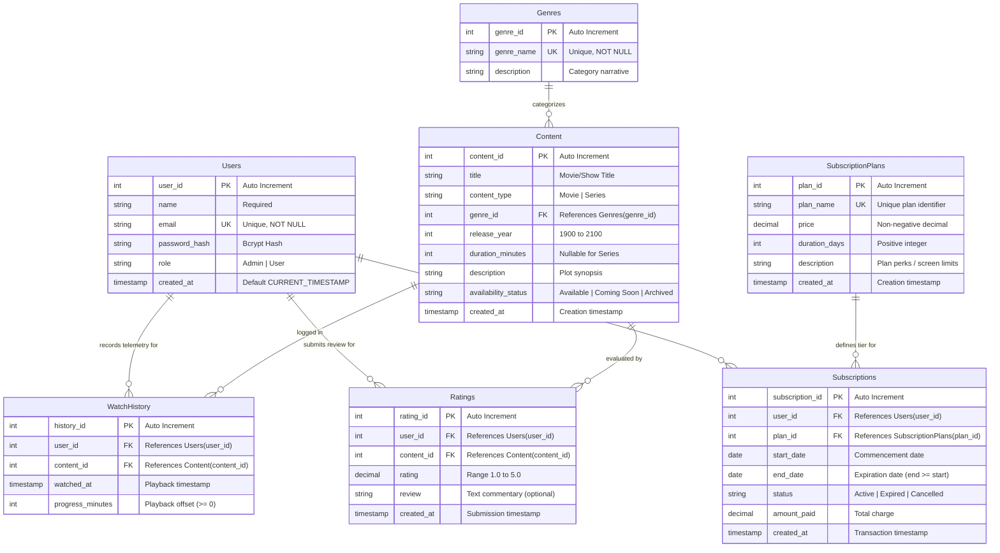

# StreamSphere OTT Platform — Entity-Relationship (ER) Documentation

## 1. Overview
This document contains the structural Entity-Relationship (ER) specification for the **StreamSphere OTT Platform Management System**, designed for relational database management and academic evaluation.

---

## 2. Mermaid ER Diagram

---

## 3. Entity Definitions & Cardinality Explanations

### 1. `Users` & `Subscriptions` (1 : N)
- **Cardinality:** One user may purchase zero, one, or multiple subscriptions over time (e.g., renewals or upgrades). Each subscription record belongs strictly to exactly one user.
- **Relational Integrity:** `ON DELETE CASCADE` ensures that when a user account is purged, their personal billing records are removed to prevent orphaned financial references.

### 2. `SubscriptionPlans` & `Subscriptions` (1 : N)
- **Cardinality:** A single subscription plan (e.g., "Premium 4K Ultra") can be chosen by zero, one, or thousands of subscribers. Each subscription points to exactly one tier.
- **Relational Integrity:** `ON DELETE RESTRICT` guarantees that no active or historical pricing plan can be deleted from the system while existing subscriptions reference it.

### 3. `Genres` & `Content` (1 : N)
- **Cardinality:** A single genre classification (e.g., "Sci-Fi", "Action") categorizes multiple movies and series. Each piece of content is categorized under a primary genre.
- **Relational Integrity:** `ON DELETE RESTRICT` prevents accidental deletion of a genre that contains active catalog titles.

### 4. `Users`, `Content`, & `WatchHistory` (M : N via Associative Entity)
- **Cardinality:** A user can stream many titles over time, and a title can be streamed by many users. The `WatchHistory` table resolves this many-to-many relationship and stores telemetry such as `progress_minutes` and `watched_at`.
- **Relational Integrity:** `ON DELETE CASCADE` ensures playback logs are cleaned up if either the user account or the content title is removed.

### 5. `Users`, `Content`, & `Ratings` (M : N via Associative Entity with Unique Constraint)
- **Cardinality:** A user can rate multiple titles, and each title collects ratings from multiple users.
- **Uniqueness Constraint:** A composite unique constraint `uq_user_content_rating UNIQUE(user_id, content_id)` enforces the business rule that a user may submit only one rating/review per title (which they can update anytime).
